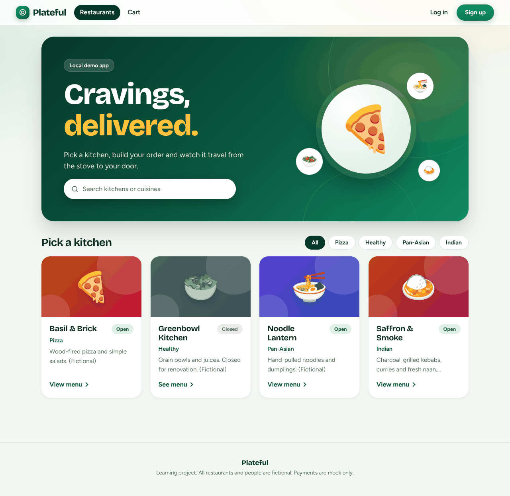
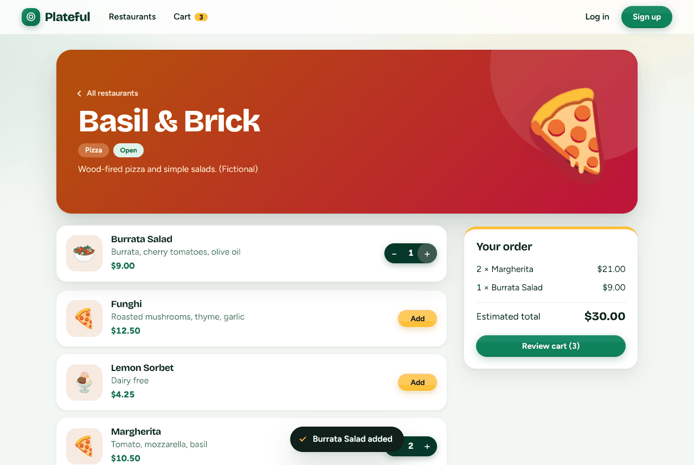
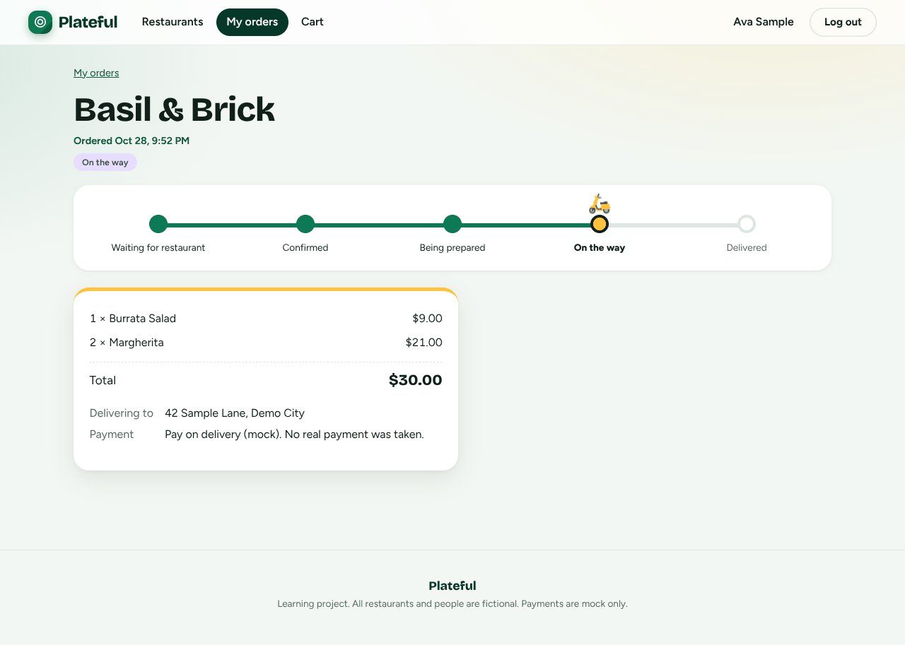
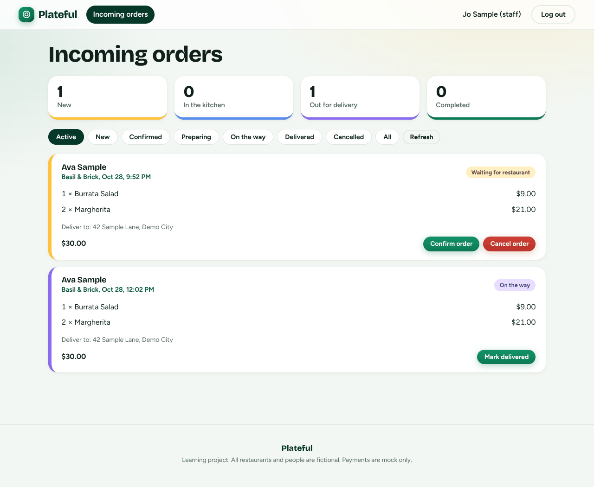
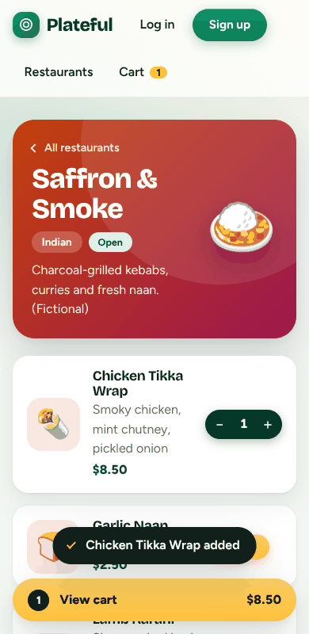

# Plateful: a local food delivery app (learning project)

React + TypeScript (Vite) frontend, FastAPI backend, PostgreSQL database. Runs on your PC from VS Code. No Docker, no cloud, no paid services. All restaurants and people are fictional. Payments are **mock only**: no card details are ever collected.

## Documentation

- **[Architecture guide](docs/ARCHITECTURE.md)**: how the app is built, request and login flows, data model, order rules, security design, and a recipe for adding features.
- **[Architecture diagram](docs/architecture.svg)** (also as [PNG](docs/architecture.png)).

| Browse | Menu and cart | Order tracking |
|---|---|---|
|  |  |  |

| Staff view | Mobile |
|---|---|
|  |  |

## How the three parts talk to each other

```
Browser (React, :5173)  --HTTP + JSON-->  FastAPI (:8000)  --SQL-->  PostgreSQL (:5432)
   src/api/client.ts                      routers -> services -> repositories
```

1. The React app only talks to the backend through `frontend/src/api/client.ts`.
2. In FastAPI, a **router** checks the request shape and who is calling, a **service** applies the business rules (prices, availability, status changes), and a **repository** is the only code that writes SQL (through SQLAlchemy, always with bound parameters).
3. PostgreSQL stores the data. **Alembic** migrations create the tables.

The frontend checks things only to be friendly (for example, hiding buttons). The **backend re-checks everything**, so changing the frontend code in the browser gains an attacker nothing.

## 1. Check your tools (PowerShell in VS Code: Terminal > New Terminal)

```powershell
py -3.13 --version      # Python 3.13.x
node --version          # Node 20+ (22 recommended)
psql --version          # psql (PostgreSQL) 17.x
```

If `psql` is "not recognized", PostgreSQL's `bin` folder isn't on your PATH. Either add `C:\Program Files\PostgreSQL\17\bin` to PATH (then reopen VS Code), or call it with the full path: `& "C:\Program Files\PostgreSQL\17\bin\psql.exe" ...`.

## 2. Create the database (once)

From the project root. This asks for the `postgres` superuser password (set when you installed PostgreSQL), then asks you to choose a password for the new app login.

```powershell
cd food-delivery
psql -U postgres -f backend\scripts\create_db.sql
```

This creates a **least-privilege** login `fooddelivery_app` (not a superuser, cannot create databases or roles) plus two databases: `fooddelivery` and `fooddelivery_test`. The app never connects as `postgres`.

## 3. Backend setup

```powershell
cd backend
py -3.13 -m venv .venv
.\.venv\Scripts\Activate.ps1
python -m pip install --upgrade pip
pip install -r requirements.txt
Copy-Item .env.example .env
```

If activation is blocked ("running scripts is disabled"), run `Set-ExecutionPolicy -Scope CurrentUser RemoteSigned` once and try again (or use `.\.venv\Scripts\activate.bat` in Command Prompt).

Now edit `backend\.env` (it is git-ignored):

- `DATABASE_URL` and `TEST_DATABASE_URL`: replace `YOUR_DB_PASSWORD` with the app password you chose in step 2. If it contains special characters (`@ : / # %`), URL-encode them.
- `JWT_SECRET`: generate one and paste it in:
  ```powershell
  python -c "import secrets; print(secrets.token_urlsafe(48))"
  ```
  The app refuses to start while this is short or still starts with `change-me`.
- `SEED_USER_PASSWORD`: pick your own password (10+ characters). It is the password of the sample accounts.

Then create the tables, add sample data and start the API:

```powershell
alembic upgrade head
python -m scripts.seed
uvicorn app.main:app --reload --port 8000
```

## 4. Frontend setup (second terminal)

```powershell
cd food-delivery\frontend
npm install
Copy-Item .env.example .env.local
npm run dev
```

## 5. URLs

| What | URL |
|---|---|
| App | http://localhost:5173 |
| API docs (Swagger) | http://localhost:8000/docs |
| API health check | http://localhost:8000/health |

Use `localhost` (not `127.0.0.1`) in the browser. CORS and cookies are configured for that exact origin.

## 6. Sample accounts

Password for all of them is whatever you put in `SEED_USER_PASSWORD`.

| Role | Email | Manages |
|---|---|---|
| Customer | ava.customer@example.com | |
| Customer | ben.customer@example.com | |
| Staff | sam.staff@example.com | Saffron & Smoke |
| Staff | jo.staff@example.com | Noodle Lantern, Basil & Brick |

There is **no default admin**. Public sign-up always creates a customer. To create a real staff account (hidden password prompt):

```powershell
python -m scripts.create_staff --email owner@example.com --name "Alex Owner" --restaurant "Noodle Lantern"
```

## 7. Run the tests

```powershell
# backend (needs the fooddelivery_test database from step 2)
cd food-delivery\backend
.\.venv\Scripts\Activate.ps1
python -m pytest

# frontend
cd ..\frontend
npm test
npm run typecheck
npm run build
```

Backend tests wipe the tables of `fooddelivery_test` between tests. They refuse to run against any database whose name does not end in `_test`.

## API endpoints

Errors always look like `{"error": {"code": "...", "message": "...", "fields": [...]}}`. Full details are in Swagger at `/docs`.

| Method and path | Who | What |
|---|---|---|
| POST `/auth/register` | public | Create a customer account, log in |
| POST `/auth/login` | public | Log in (rate limited) |
| POST `/auth/refresh` | refresh cookie | Rotate refresh token, get a new access token |
| POST `/auth/logout` | refresh cookie | Revoke the refresh token |
| GET, PATCH `/auth/me` | logged in | View or edit profile |
| GET `/restaurants` | public | List restaurants |
| GET `/restaurants/{id}/menu` | public | Restaurant and its menu |
| POST `/orders` | customer | Place an order (server prices it) |
| GET `/orders`, GET `/orders/{id}` | customer | Own orders only |
| POST `/orders/{id}/cancel` | customer | Cancel own order while `pending` |
| GET `/staff/orders?status=` | staff | Orders of restaurants you manage |
| PATCH `/staff/orders/{id}/status` | staff | Move an order to the next status |

### Order status rules (enforced by the server)

`pending` → `confirmed` or `cancelled`; `confirmed` → `preparing` or `cancelled`; `preparing` → `out_for_delivery`; `out_for_delivery` → `delivered`. `delivered` and `cancelled` are final.

## Data model

- **users**: email (unique, lowercase), Argon2id `password_hash`, `role` (`customer` or `staff`).
- **refresh_tokens**: belongs to a user. Stores only a SHA-256 hash of the token, an expiry and a revoked time.
- **restaurants** has many **menu_items** (price is `NUMERIC(10,2)` with a non-negative check).
- **restaurant_staff**: links a staff user to the restaurants they may manage (many-to-many).
- **orders**: belongs to a customer and a restaurant. Has `status`, `total`, address, mock `payment_method`, timestamps.
- **order_items**: belongs to an order. Copies `item_name` and `unit_price` **at purchase time**, so later menu edits never change history. `menu_item_id` becomes `NULL` if the menu item is deleted.
- Deleting a user or restaurant that has orders is blocked (`RESTRICT`). Indexes cover "my orders" and "restaurant's orders by status".

## Security summary

| Area | What is done |
|---|---|
| Passwords | Argon2id hashing. Never stored or logged in plain text. Unknown emails still do a hash check so timing doesn't reveal which accounts exist. |
| Login tokens | Access token is a JWT that lasts 15 minutes and is kept **only in JavaScript memory** (not localStorage). The refresh token is an opaque random value in an `HttpOnly`, `SameSite=Strict` cookie limited to `/auth`. The database stores only its hash. |
| Refresh rotation | Every refresh token works once. If an old one is replayed, all of that user's sessions are revoked. |
| CSRF | The cookie is only used by `/auth/refresh` and `/auth/logout`. Those require a custom header plus a matching `Origin`. All other endpoints use the `Authorization` header, which other sites can't set. |
| Authorization | Every protected endpoint checks the role. Order lookups by ID return 404 for orders that aren't yours (no ID probing). Staff are limited to their linked restaurants. Role is read from the database, not the token. |
| Input | Pydantic validates everything and **rejects unknown fields** (so a browser can't submit a `total`). Validation errors never echo submitted values. |
| Orders | Prices and availability come from the database. Totals use exact decimals. Order and items save in one transaction. Status changes lock the row so two requests can't race. |
| SQL | SQLAlchemy bound parameters only. `hide_parameters` keeps values out of error text. |
| CORS | Only `FRONTEND_ORIGIN`, with listed methods and headers. |
| Headers | `nosniff`, `X-Frame-Options: DENY`, `no-referrer`, a strict CSP on API responses, HSTS when `COOKIE_SECURE=true`. |
| Errors and logs | Unexpected errors return a generic message. Details go only to the server log. Passwords and tokens are never logged. |
| Database | App connects as a non-superuser. |
| Secrets | `.env` is git-ignored. `.env.example` has placeholders only. The app refuses weak or placeholder `JWT_SECRET`. Seeding refuses placeholders and refuses to run in production. |
| Staff access | No hidden admin. Staff are created on purpose with a script. |

### Limitations (read before going beyond local use)

- **Rate limiting is in memory.** It works for one local process but resets on restart and isn't shared across workers. In production, use Redis or rate limit at a reverse proxy. Behind a proxy, configure trusted proxy headers so the real client IP is used.
- **Local cookies are not `Secure`.** Some browsers (Safari, for example) reject `Secure` cookies over plain `http://`, so `COOKIE_SECURE=false` locally. In production set `ENVIRONMENT=production` and `COOKIE_SECURE=true` behind HTTPS (the app refuses to start otherwise). Docs are also switched off in production.
- **Cookies assume the same "site".** `SameSite=Strict` works when frontend and API share a registrable domain (like `localhost:5173` and `localhost:8000`, or `app.example.com` and `api.example.com`).
- **Registration reveals if an email is taken** ("account already exists"). This is a common trade-off, limited by rate limiting.
- **No email verification, password reset, or account lockout.** Out of scope here.
- **The access token can't be revoked mid-life** (up to 15 minutes), a standard JWT trade-off. Logout revokes the refresh token, so no new access tokens are issued.
- **One migration/runtime login.** For production, use a separate, more restricted runtime login that can't alter tables.
- **No menu editing screens.** Menus are managed through seed data or SQL.
- **Orders list is polled** (every 8 or 15 seconds), not pushed live.
- **Same-restaurant carts only.** A cart holds items from one restaurant at a time.

## Manual test guide

Do these with backend and frontend running and seed data loaded.

1. **Browse:** open http://localhost:5173. You see 4 restaurant cards. "Greenbowl Kitchen" shows Closed and its menu has no Add buttons. Type `noodle` in the search box, then try the cuisine chips (Pizza, Indian, and so on).
2. **Menu and cart:** open Saffron & Smoke. "Pistachio Kulfi" says Unavailable. Add Chicken Tikka Wrap, use + to make it 2, check the side panel total ($17.00).
3. **Phone layout:** make the browser window narrow (under 860px wide). A yellow **View cart** bar sticks to the bottom of the menu page.
4. **Cart rules:** go to the cart, change quantities, remove an item, empty the cart. The empty state should appear.
5. **Auth gate:** with an item in the cart, click checkout while logged out. You are sent to log in, then returned.
6. **Registration errors:** try a 6-character password. You should see a message under the password field. Try an already used email. You should see a clear error.
7. **Login:** wrong password shows "Incorrect email or password." Correct login as ava.customer@example.com works. Reload the page. You should stay logged in (silent refresh).
8. **Checkout:** the payment box is labelled **mock**. There are no card fields. Place the order and confirm you land on the order page with the tracker at "Waiting for restaurant".
9. **Staff:** in a private window, log in as sam.staff@example.com. You see Ava's order under Incoming orders. Click **Confirm order**. Back in Ava's window, within 8 seconds the tracker moves to Confirmed.
10. **Cancel rules:** as Ava, a *confirmed* order has no Cancel button. Place another order and cancel it while pending.
11. **Authorization:** log in as ben.customer@example.com, paste the URL of Ava's order (`/orders/<id>`). You get a not found error. In Swagger at `/docs`, calling `/staff/orders` with Ben's token returns 403.
12. **Staff scope:** jo.staff@example.com should not see Saffron & Smoke orders.
13. **Bad transitions:** in Swagger, as staff, try to set a `pending` order straight to `delivered`. You get 409.
14. **Errors:** stop the backend and refresh the restaurants page. You see "Can't reach the server" with a Try again button. Start it again and click the button.
15. **Logout:** log out, then press Back. Protected pages send you to log in.

## Running several API instances (high availability)

`cluster/` runs several copies of the API behind a Caddy load balancer, so if one crashes the others keep serving and the crashed one is restarted automatically. The frontend keeps using `http://localhost:8000`. See [cluster/README.md](cluster/README.md).

## Load testing

`loadtest/` has two programs that simulate customers placing orders and staff processing them, with a settable order rate and number of users. See [loadtest/README.md](loadtest/README.md).

## Troubleshooting

- **`password authentication failed`**: check the password in `DATABASE_URL` (URL-encode special characters).
- **App won't start, mentions JWT_SECRET**: generate a real secret (step 3).
- **CORS error in the browser console**: open the app at exactly `http://localhost:5173` and keep `FRONTEND_ORIGIN` the same.
- **Port 5173 in use**: close the other Vite instance. The port is fixed on purpose so it matches CORS.
- **Logged out after reload**: make sure you use `localhost` (not `127.0.0.1`) for the app, and that the backend is running.
