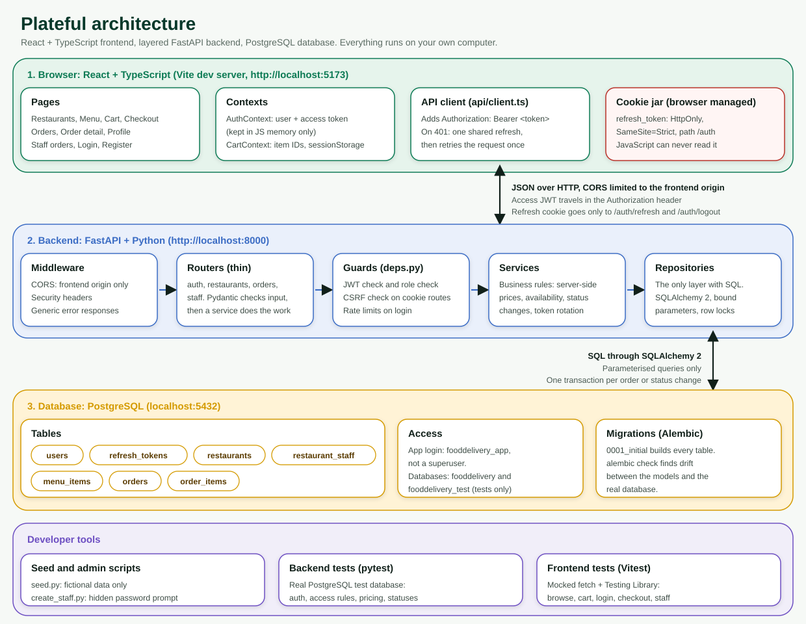
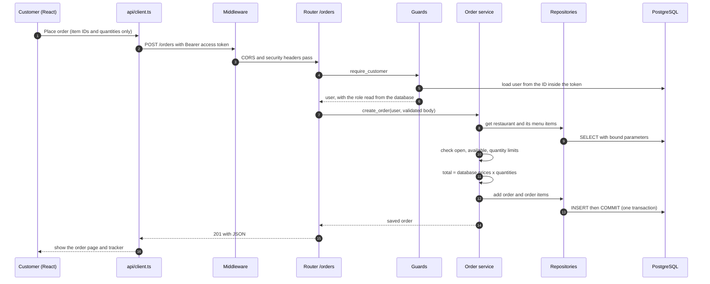
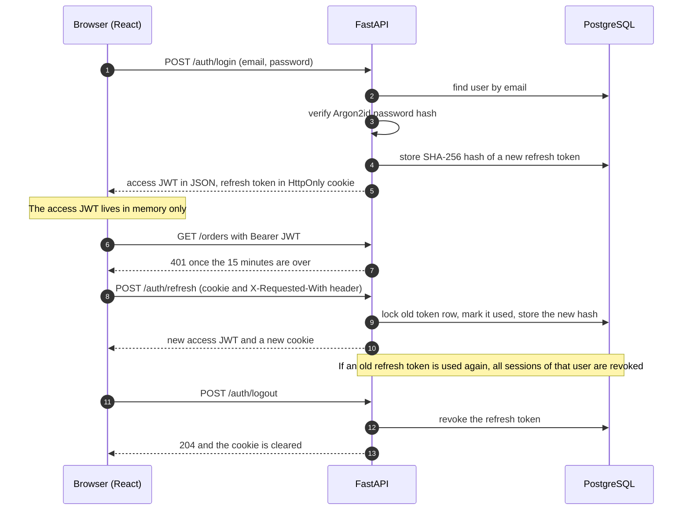
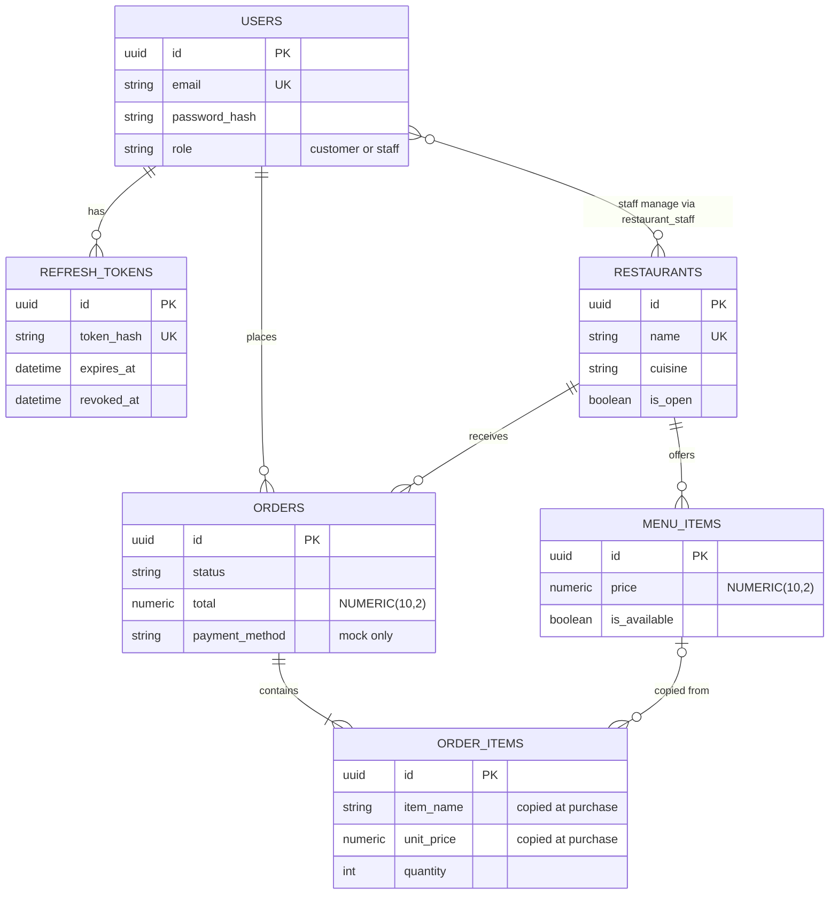
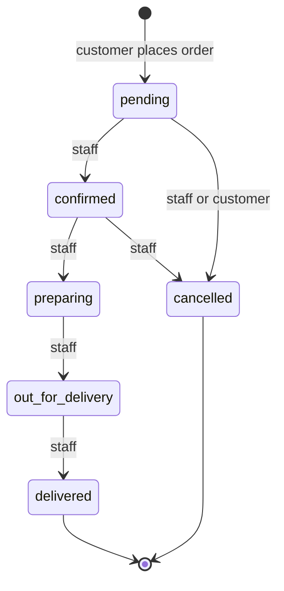
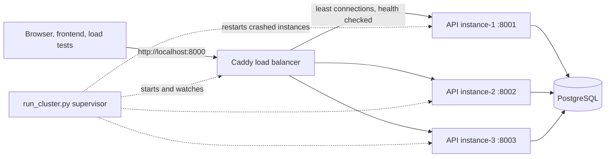
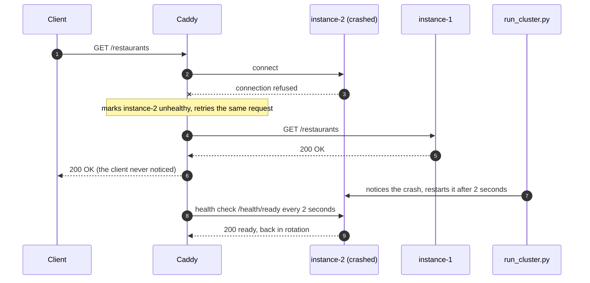

# Plateful architecture

This document explains how the app is built, why it is built that way, and where to look when you want to change something. It is written for someone learning the project.

**In one sentence:** a React app talks JSON over HTTP to a FastAPI server, which applies the business rules and stores everything in PostgreSQL.



> Mermaid diagrams below render on GitHub. In VS Code, install the extension **Markdown Preview Mermaid Support**, then open the preview (Ctrl+Shift+V).

---

## 1. The three tiers

| Tier | Technology | Runs on | Its job |
|---|---|---|---|
| Browser | React 19, TypeScript, Vite | http://localhost:5173 | Show screens, collect input, call the API |
| Backend | FastAPI, Pydantic, SQLAlchemy 2 | http://localhost:8000 | Check who you are, enforce every rule, talk to the database |
| Database | PostgreSQL 17 | localhost:5432 | Store users, menus and orders safely |

The most important rule: **the browser is never trusted.** The frontend checks things only to be friendly (for example, hiding a button). The backend checks everything again.

---

## 2. How one request travels: placing an order



What to notice:

- The browser sends **IDs and quantities only**. It cannot send a price or total. The input model rejects unknown fields, so extra fields cause a `422` error.
- The price comes from the database at the moment of ordering. The item name and price are **copied into `order_items`**, so later menu edits never change old orders.
- The order and all its items are saved in **one transaction**. If anything fails, nothing is saved.

---

## 3. Login, refresh and logout



Two tokens, two jobs:

| Token | Lifetime | Where it lives | Why |
|---|---|---|---|
| Access token (JWT) | 15 minutes | JavaScript memory only | Short life limits damage if it leaks. Not in localStorage, so a script injected into the page cannot read it from storage. |
| Refresh token | 7 days, single use | `HttpOnly` cookie, `SameSite=Strict`, path `/auth` | JavaScript cannot read it. The browser sends it only to `/auth/*`. The database stores only its hash. |

After a page reload the access token is gone, so `AuthContext` quietly calls `/auth/refresh` to get a new one. `client.ts` uses **one shared refresh at a time**, because refresh tokens work only once.

---

## 4. Backend layers

Each layer has one job. Keeping them apart makes the code easy to read and easy to test.

| Layer | Files | Does | Must not |
|---|---|---|---|
| Middleware | `app/main.py`, `app/errors.py` | CORS, security headers, one safe error format | Contain business logic |
| Routers | `app/routers/*.py` | Parse the request, call a service, return the response | Write SQL or make decisions |
| Guards | `app/deps.py`, `app/limiter.py` | Check the token, role, CSRF header, rate limits | Load business data |
| Services | `app/services/*.py` | **All business rules**: pricing, availability, status changes, token rotation | Build SQL strings |
| Repositories | `app/repositories/*.py` | **The only place with queries** (SQLAlchemy, bound parameters, row locks) | Decide rules |
| Models and schemas | `app/models.py`, `app/schemas.py` | Table shapes, and input and output shapes | Hold behaviour |
| Config and security | `app/config.py`, `app/security.py` | Settings from `.env`, Argon2, JWT, token hashing | Print or log secrets |

A rule of thumb: if you are asking "is this allowed?", it belongs in a **service**. If you are asking "how do I fetch it?", it belongs in a **repository**.

---

## 5. Data model



- **Money is `NUMERIC(10,2)`**, never a float. Python uses `Decimal`. The API sends money as strings such as `"8.50"`.
- **Snapshots:** `order_items` keeps its own name and price. `menu_item_id` becomes `NULL` if the menu item is later deleted, so history is never lost.
- **Delete rules:** deleting a user or restaurant that has orders is blocked (`RESTRICT`). Deleting a user removes their refresh tokens (`CASCADE`).
- **Checks in the database itself:** valid roles, valid statuses, valid payment labels, non-negative prices, quantity above zero. Even a bug in the code cannot save these invalid values.
- **Indexes:** "my orders" (`customer_id, created_at`), "restaurant orders by status" (`restaurant_id, status`), menu by restaurant.
- **Migrations:** `alembic/versions/0001_initial.py` creates everything. `alembic check` confirms the models and the real database still agree.

---

## 6. Order status rules



- The allowed moves live in **one table**: `TRANSITIONS` in `app/services/orders.py`. Anything not listed is rejected with `409`.
- A test checks **all 36 pairs** of statuses against that table.
- Changing a status first **locks the order row** (`SELECT ... FOR UPDATE`), so two people clicking at once cannot break the rules.
- Customers can cancel only while `pending`. Staff can change only orders of restaurants linked to them in `restaurant_staff`.
- Unknown or foreign order IDs return `404`, the same as a missing order, so IDs cannot be probed.

---

## 7. Security design

| Risk | Defence | Where |
|---|---|---|
| Stolen password database | Argon2id hashes. Unknown emails still run a hash check, so timing does not reveal which accounts exist. | `security.py`, `services/auth.py` |
| Token theft by an injected script (XSS) | Access token only in memory. Refresh token is `HttpOnly`. 15 minute access life. | `api/client.ts`, `routers/auth.py` |
| Stolen refresh token | Single use, rotated every time. Re-use revokes all sessions. Only a hash is stored. | `services/auth.py` |
| Cross-site request forgery (CSRF) | Cookie routes need a custom header plus a matching `Origin`. `SameSite=Strict`. Every other route uses the `Authorization` header, which other sites cannot set. | `deps.py` |
| Changing an ID in the URL | Every query is filtered by owner or by staff link. Not yours means `404`. | `services/orders.py` |
| A customer calling staff routes | Role check on every protected route. Role is read from the database, not from the token. | `deps.py` |
| Price tampering | Browser sends IDs and quantities. Totals come from the database. Unknown fields are rejected. | `schemas.py`, `services/orders.py` |
| SQL injection | SQLAlchemy bound parameters everywhere. No string-built SQL. | `repositories/` |
| Password guessing | Rate limits per IP and per email. | `limiter.py` |
| Another website calling the API | CORS allows only the frontend origin. | `main.py` |
| Leaking details in errors | One safe error format. Validation errors never echo submitted values. Database parameters are hidden. | `errors.py`, `database.py` |
| Weak secrets | The app refuses a short or placeholder `JWT_SECRET`, and never prints the rejected value. | `config.py` |
| Over-powerful database login | App uses a non-superuser role that owns only its two databases. | `scripts/create_db.sql` |
| Hidden admin accounts | None. Public sign-up always makes a customer. Staff are created with `create_staff.py`. | `services/auth.py`, `scripts/` |

---

## 8. Frontend architecture

```
src/
  api/        client.ts (the only code that calls the backend), types.ts
  context/    AuthContext (user, login, logout), CartContext (cart in sessionStorage)
  components/ Layout, ProtectedRoute, States (loading, error, empty), Stepper, StatusBadge/OrderTracker
  pages/      one file per screen
  hooks.ts    useFetch (loading/error/data), useInterval (polling)
  visuals.ts  emoji and colour themes per cuisine
  format.ts   money and status labels
  styles.css  design tokens and all styling
```

- **Routing:** React Router. `ProtectedRoute` hides pages from the wrong role. This is for convenience only. The backend does the real blocking.
- **State:** two small contexts. No state library is needed at this size.
- **Every screen handles four states:** loading (skeleton cards or spinner), error (message plus **Try again**), empty (helpful message plus a next step), and success.
- **Live updates:** the order page checks again every 8 seconds, and the staff page every 15 seconds. Polling is simple and enough here. WebSockets would be the next step.
- **Cart:** held in the browser (`sessionStorage`) as item IDs and quantities. It is not sensitive, and the server re-prices everything at checkout.
- **Look and feel:** colour, spacing, shadows and motion are tokens at the top of `styles.css`. There are no photos in this demo, so each cuisine gets a colour theme and food emoji from `visuals.ts`. Motion is turned off for people who prefer reduced motion.
- **Accessibility:** labelled form fields, visible focus rings, `aria-live` for the cart and toast, a skip link, and buttons with clear names.

---

## 9. Key decisions and trade-offs

- **JWT access token plus rotating refresh cookie, not server sessions.** It matches your choice and works well with a separate frontend. Trade-off: a leaked access token stays valid for up to 15 minutes. Logging out stops new tokens from being issued.
- **Services and repositories instead of logic inside routes.** A bit more code, but each piece is small, readable and easy to test.
- **Rejecting unknown input fields.** Stricter than the default, but it turns a whole class of tampering into a clear error.
- **Cart in the browser, not the database.** Less to build. The cost is that carts do not follow you between devices.
- **In-memory rate limiting.** No extra service to install. The cost is that it resets on restart and cannot be shared between several servers.
- **Polling, not WebSockets.** Much simpler to build and debug. The cost is up to a few seconds of delay.
- **Emoji instead of photos.** No image files to host, and the demo stays fully fictional.
- **One database login for migrations and the app.** Simplest for learning. Production should use two logins, one that can change tables and one that cannot.

---

## 10. How to add a feature (recipe)

For example, "restaurant staff can mark a menu item unavailable":

1. **Model and migration:** change `models.py` if the table changes, then `alembic revision -m "..."`, edit it, run `alembic upgrade head`, and confirm `alembic check` is clean.
2. **Repository:** add the query in `repositories/catalog.py`.
3. **Service:** add the rule (is this staff member linked to the restaurant?) in `services/`.
4. **Schema:** add the input model in `schemas.py`, with `extra="forbid"`.
5. **Router:** add a thin route in `routers/staff.py` using `require_staff`.
6. **Backend tests:** success, wrong role (`403`), wrong restaurant (`404`), bad input (`422`).
7. **Frontend:** add the function to `api/client.ts` and its type to `types.ts`, then the screen change.
8. **Frontend tests:** the happy path and one error path.

---

## 11. Local configuration at a glance

| Setting | Where | Notes |
|---|---|---|
| `DATABASE_URL` | `backend/.env` | Non-superuser login `fooddelivery_app` |
| `TEST_DATABASE_URL` | `backend/.env` | Must end in `_test`. Tests wipe its tables. |
| `JWT_SECRET` | `backend/.env` | 32+ random characters. Never commit. |
| `FRONTEND_ORIGIN` | `backend/.env` | The only allowed CORS origin. Must match the address you open. |
| `COOKIE_SECURE` | `backend/.env` | `false` locally. **Must be `true`** behind HTTPS in production. |
| `VITE_API_URL` | `frontend/.env.local` | Public value only. Never put secrets in `VITE_` variables. |

Production notes: serve both parts over HTTPS, set `ENVIRONMENT=production` and `COOKIE_SECURE=true`, use a shared store for rate limits, and use separate database logins for migrations and the app. See the **Limitations** section of the main README.

---

## 12. Running several instances (high availability)

The diagram at the top shows one API. To survive a crash, run **several copies** behind a load balancer. Setup steps are in `cluster/README.md`.



**What happens when an instance crashes**



**Why this app can scale out so easily**

- The access token is a **stateless JWT**, so any instance can verify it.
- Refresh tokens, orders and users are **in PostgreSQL**, not in a process's memory.
- The cart lives in the browser, and the order tracker simply asks the API again.
- So no "sticky sessions" are needed: the load balancer can send each request anywhere.

**What was added to make it work**

- `/health/ready`: runs `SELECT 1`. The load balancer uses it, so an instance that cannot reach the database stops getting traffic.
- `X-Instance` header on every response, so you can see which copy answered.
- Database pool size is now a setting, divided between instances so the total stays under PostgreSQL's 100 connections.
- `run_cluster.py`: starts the instances and Caddy, and restarts any that die.

**Known limits** (also in the cluster README)

- A request that was in flight on the instance when it crashed fails. Caddy does not re-send it, because re-sending `POST /orders` could create a duplicate order.
- The rate limiter counts per instance, so limits are looser than with one instance. A shared store (Redis or the database) would fix this.
- The load balancer, PostgreSQL and the single computer are still single points of failure. This design protects against API process crashes, not machine or database failure.
- The diagram image `architecture.svg` still shows the single-instance view.
